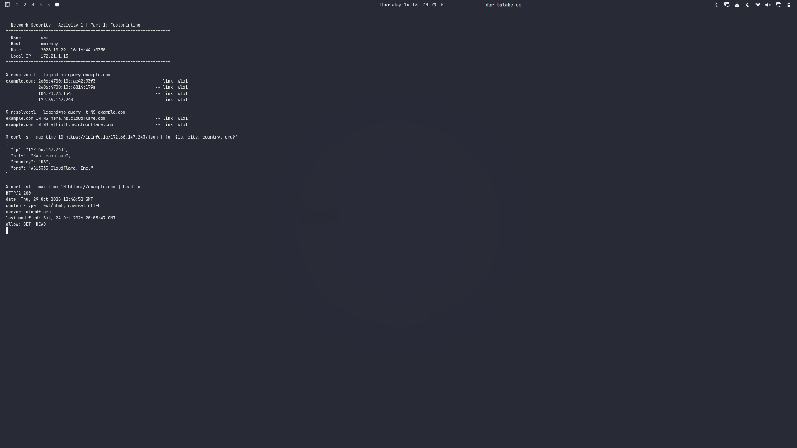
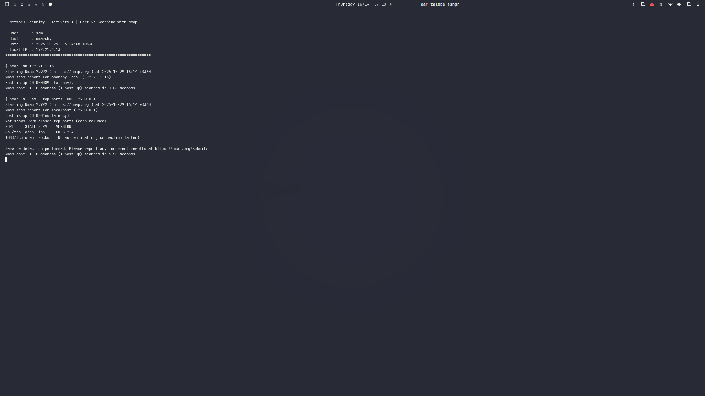
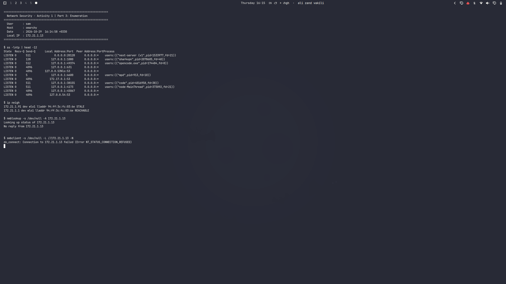

# گزارش فعالیت ۱: مرحله شناسایی حملات سایبری

این گزارش مربوط به فاز شناسایی است: Footprinting، Scanning و Enumeration. همه دستورها را روی لپ‌تاپ خودم اجرا کردم که لینوکس دارد، چون به ماشین مجازی ویندوز آزمایشگاه CEH دسترسی نداشتم. خروجی دستورها را همان‌طور که بود در گزارش گذاشته‌ام و بعد از هر قسمت نوشته‌ام که از آن چه چیزی فهمیدم.

## الف) مفاهیم

### جدول ۱: سه مرحله شناسایی

| مرحله | اطلاعاتی که به دست می‌آید |
|---|---|
| **Footprinting** | اطلاعات عمومی هدف. دامنه و زیردامنه‌ها، رکوردهای DNS، محدوده IP، اطلاعات ثبت دامنه (WHOIS)، ایمیل و نام کارمندان، تکنولوژی وب‌سایت. این اطلاعات از منابع عمومی جمع می‌شود و لازم نیست مستقیم با هدف تماس بگیریم. |
| **Scanning** | هاست‌های زنده در شبکه، پورت‌های باز و بسته، سرویس هر پورت و نسخه‌اش، و نشانه‌های پیکربندی ناامن. |
| **Enumeration** | جزئیات داخل سرویس‌های باز. نام کاربر و گروه، شیرهای اشتراکی، نام NetBIOS و آدرس MAC، اطلاعات SNMP و جدول مسیریابی. |

### جدول ۲: سه نوع اسکن

| نوع اسکن | هدف |
|---|---|
| **Port scanning** | مشخص کردن پورت‌های باز TCP و UDP روی یک هاست و فهمیدن سرویس هر پورت. |
| **Network scanning** | پیدا کردن هاست‌های زنده در یک محدوده IP و رسم نقشه شبکه. |
| **Vulnerability scanning** | جست‌وجوی خودکار آسیب‌پذیری‌های شناخته‌شده و نسخه‌های قدیمی. نتیجه‌اش باید دستی هم بررسی شود. |

## ب) بخش عملی

### ب-۱) فهرست آزمایش‌های ۱ تا ۱۰ فصل Footprinting

فهرست آزمایش‌های این فصل و ابزار هر کدام:

| # | موضوع آزمایش | ابزار | کارکرد |
|---|---|---|---|
| ۱ | جست‌وجو در موتورهای جست‌جو | Google, Google Hacking Database | پیدا کردن صفحات، فایل‌ها و مسیرهای افشاشده سایت هدف |
| ۲ | جمع‌آوری اطلاعات از سرویس‌های اینترنتی | AnyWho, Pipl | پیدا کردن اطلاعات افراد و سازمان از دایرکتوری‌های عمومی |
| ۳ | بررسی شبکه‌های اجتماعی | جست‌وجوی LinkedIn, Facebook, X | پیدا کردن کارمندان، ایمیل و اطلاعات سازمانی |
| ۴ | بررسی سایت‌های استخدامی | LinkedIn Jobs, Indeed | حدس زدن تکنولوژی‌های سازمان از آگهی استخدام |
| ۵ | بررسی وب‌سایت | HTTrack, Archive.org, Netcraft | ذخیره یا بررسی آفلاین سایت و شناسایی سرور و تکنولوژی آن |
| ۶ | استعلام WHOIS | `whois`, DomainTools | اطلاعات ثبت دامنه: ثبت‌کننده، تاریخ ثبت، Name Server |
| ۷ | پرس‌وجوی DNS | `nslookup`, `dig`, DNSdumpster | گرفتن رکوردهای A، MX، NS، TXT و زیردامنه‌ها |
| ۸ | ردیابی مسیر شبکه | `tracert`, `traceroute`, Path Analyzer Pro | دیدن روترهای مسیر تا مقصد و حدس محدوده شبکه |
| ۹ | جمع‌آوری ایمیل و زیردامنه | theHarvester | استخراج ایمیل، نام کاربر و زیردامنه از منابع عمومی |
| ۱۰ | جمع‌آوری اطلاعات با ابزارهای گرافیکی | Recon-ng, Maltego, OSRFramework | جمع‌آوری و نمایش ارتباط بین اطلاعات هدف |

### ب-۲) آزمایش انتخاب‌شده: پرس‌وجوی DNS

از بین آزمایش‌های ۲ تا ۱۰، آزمایش پرس‌وجوی DNS را انتخاب کردم. اول رکوردهای A و AAAA دامنه `example.com` را گرفتم، بعد Name Serverها را، و آخر سر یک استعلام روی IP همین دامنه زدم تا ببینم مال چه سازمانی است.

```text
$ resolvectl --legend=no query example.com
example.com: 2606:4700:10::ac42:93f3
             2606:4700:10::6814:179a
             104.20.23.154
             172.66.147.243

$ resolvectl --legend=no query -t NS example.com
example.com IN NS elliott.ns.cloudflare.com
example.com IN NS hera.ns.cloudflare.com

$ curl -s https://ipinfo.io/172.66.147.243/json
{
  "ip": "172.66.147.243",
  "city": "San Francisco",
  "country": "US",
  "org": "AS13335 Cloudflare, Inc."
}

$ curl -sI https://example.com
HTTP/2 200
content-type: text/html; charset=utf-8
server: cloudflare
last-modified: Sat, 24 Oct 2026 20:05:47 GMT
allow: GET, HEAD
```

دامنه چهار رکورد A/AAAA دارد و هر دو Name Server آن از Cloudflare است. استعلام IP هم همان را تأیید کرد: آدرس‌ها مال `Cloudflare, Inc.` با شماره `AS13335` هستند و هدر HTTP هم `server: cloudflare` برمی‌گرداند.

یعنی هر سه راه به یک جواب رسیدند. این سایت پشت CDN کلادفلر است و IPهایی که DNS برمی‌گرداند آدرس خود کلادفلر هستند، نه سرور اصلی سازمان. برای همین با این روش نمی‌شود فهمید سرور واقعی کجاست یا محدوده شبکه سازمان چیست. در گزارش‌گیری واقعی این حالت کار را سخت می‌کند.

### ب-۳) اسکن با Nmap

از فصل Scanning، Nmap را انتخاب کردم؛ هم روی لینوکس هست و هم در خود کتاب آمده. اول با `-sn` چک کردم هاست خودم در شبکه زنده است یا نه، بعد پورت‌ها و سرویس‌ها را اسکن کردم.

```text
$ nmap -sn 172.21.1.13
Nmap scan report for omarchy.local (172.21.1.13)
Host is up (0.00010s latency).

$ nmap -sT -sV --top-ports 1000 127.0.0.1
Not shown: 998 closed tcp ports (conn-refused)
PORT     STATE SERVICE VERSION
631/tcp  open  ipp     CUPS 2.4
1080/tcp open  socks5  (No authentication; connection failed)
```

هاست زنده بود و با نام `omarchy.local` شناخته شد. از ۱۰۰۰ پورت متداول، ۹۹۸ پورت بسته بود و فقط دو پورت باز ماند: ۶۳۱ که سرویس چاپ CUPS نسخه 2.4 است و ۱۰۸۰ که پروکسی SOCKS5 کلاینت VPN باز کرده.

یک چیز برای خودم جالب بود. وقتی روی IP شبکه (`172.21.1.13`) اسکن کردم هیچ پورت بازی نبود، ولی روی `127.0.0.1` دو پورت باز بود. دلیلش این است که هر دو سرویس فقط به loopback وصل شده‌اند و از بیرون دیده نمی‌شوند. با این حال Nmap نسخه CUPS را دقیق تشخیص داد؛ اگر همین سرویس روی یک اینترفیس عمومی گوش می‌داد، از شبکه هم دیده می‌شد و می‌شد دنبال اکسپلویت همان نسخه گشت.

### ب-۴) اطلاعاتی که از اسکنرهای NetBIOS و SNMP به دست می‌آید

این دو نوع اسکنر دو جنس اطلاعات متفاوت می‌دهند.

**NetBIOS** (مثل SuperScan) روی سرویس‌های اشتراک فایل ویندوز کار می‌کند. اگر سرویس فعال باشد این‌ها را می‌شود دید: نام کامپیوتر و نام Workgroup یا Domain، جدول نام‌های NetBIOS و آدرس MAC، و لیست شیرهای اشتراکی مثل `\\host\share`. در حالت null session چیزهای بیشتری هم لو می‌رود: لیست کاربران و گروه‌ها، سیاست رمز، اطلاعات دامنه و نسخه سیستم‌عامل.

**SNMP** (مثل SolarWinds) از دستگاه‌های شبکه اطلاعات مدیریتی می‌خواند: نام، توضیح، مکان و زمان کارکرد دستگاه، سازنده و مدل، نسخه سیستم‌عامل، لیست رابط‌های شبکه با IP و MAC و وضعیتشان، جدول مسیریابی، همسایه‌های ARP و شمارنده ترافیک. بسته به MIB و سطح دسترسی ممکن است لیست پروسه‌ها و نرم‌افزارهای نصب‌شده هم در بیاید.

نکته امنیتی‌اش این است که SNMP نسخه ۱ و ۲c با community string پیش‌فرض (مثل `public`) همه این اطلاعات را بدون رمز می‌دهد. باید SNMP v3 با احراز هویت استفاده شود یا سرویس کلاً بسته شود.

### ب-۵) آزمایش انتخاب‌شده: شمارش (Enumeration)

از آزمایش‌های این فصل، آزمایش شمارش NetBIOS را انتخاب کردم چون ابزارش (SuperScan) همان کاری را می‌کند که در کلاس درباره‌اش صحبت کردیم. SuperScan مال ویندوز است و روی سیستم من نبود، پس از `nmblookup` استفاده کردم که همین پرس‌وجو را انجام می‌دهد. کنارش `ss` و `ip neigh` را هم زدم که ببینم از خود سیستم چه اطلاعاتی می‌شود درآورد.

```text
$ ss -lntp | head -12
LISTEN 0 511  0.0.0.0:20128      users:(("next-server (v1",pid=1533977))
LISTEN 0 128  127.0.0.1:1080     users:(("sharkvpn",pid=2078605))
LISTEN 0 512  127.0.0.1:49374    users:(("opencode.exe",pid=174484))
LISTEN 0 4096 127.0.0.1:631
LISTEN 0 5    127.0.0.1:6600     users:(("mpd",pid=913))
...

$ ip neigh
172.21.1.1 dev wlo1 lladdr 94:ff:3c:fc:03:6e REACHABLE

$ nmblookup -s /dev/null -A 172.21.1.13
Looking up status of 172.21.1.13
No reply from 172.21.1.13

$ smbclient -s /dev/null -L //172.21.1.13 -N
do_connect: Connection to 172.21.1.13 failed (Error NT_STATUS_CONNECTION_REFUSED)
```

پرس‌وجوی NetBIOS جواب نداد و `smbclient` هم اتصال را رد کرد، چون روی این سیستم سرویس SMB/NetBIOS نصب نیست. پس چیزی برای شمارش وجود نداشت و نتوانستم نام کاربر یا شیر اشتراکی دربیاورم. برای اجرای واقعی این آزمایش با SuperScan باید ماشین ویندوز آزمایشگاه باشد.

از طرف دیگر `ss` نشان داد سرویس‌های گوش‌دهنده و پروسه صاحب هر پورت را می‌شود بدون هیچ ابزار خاصی از خود سیستم هم دید، و `ip neigh` هم آدرس MAC روتر (gateway) را داد. این دو تا با اینکه خیلی ساده‌اند، همان جنس اطلاعاتی را می‌دهند که در enumeration دنبالش هستیم.

## چند نکته درباره اجرا

- بعضی ابزارهای این فصل (SuperScan و Path Analyzer Pro) مال ویندوز هستند و روی سیستم من نبودند؛ معادل لینوکسی‌شان را استفاده کردم.
- شبکه‌ای که به آن وصل بودم پورت ۴۳ (WHOIS) و ICMP را می‌بست. برای همین به جای WHOIS از `ipinfo.io` استفاده کردم و `traceroute` را نتوانستم اجرا کنم؛ جایش رکوردهای DNS و هدر HTTP را بررسی کردم.
- اسکن فقط روی سیستم خودم بود و هیچ هاست دیگری در شبکه را اسکن نکردم.

## اسکرین‌شات‌ها

<div class="shot"><p><strong>ب-۲: ردپایابی (DNS و اطلاعات IP)</strong></p></div>

<div class="shot"><p><strong>ب-۳: اسکن با Nmap</strong></p></div>

<div class="shot"><p><strong>ب-۵: شمارش (Enumeration)</strong></p></div>

